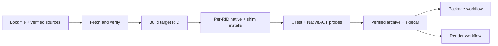

# Native build

Use this guide to follow locked OpenUSD inputs through host-specific native installs, verified
archives, and the package and render consumers that reuse them.

**On this page:** [Build and archive flow](#build-and-archive-flow) ·
[Locked inputs](#locked-inputs) · [Cesium-native quarantine](#cesium-native-quarantine) ·
[PhysX quarantine](#physx-quarantine) ·
[Local build](#local-build) · [Archive consumers](#verified-archives-and-consumers) ·
[macOS install names](#macos-install-name-policy) · [Related documentation](#related-documentation)

## Build and archive flow



The archive is a transport for verified install trees, not a second build product with different
contents.

## Locked inputs

The native runtime is pinned to OpenUSD v26.08 commit
`ee47c679abde5b467a7b6a41f3b2285564a4222e`. `eng/openusd.lock.json` records the OpenUSD archive
hash, the upstream build-script hash, every direct dependency archive hash, and the platform
toolchain matrix.

The verified upstream build script binds every native dependency URL and version to the lock,
including separately built Imath, libdeflate and Zstandard required by current OpenEXR and Ptex.
Those inputs stay in the OpenUSD prefix rather than resolving from the quarantined Cesium tree.
The dependency archives and build-script transformation are hash-verified before compilation.

The fetch step applies verified compatibility patches to the upstream build script: Windows Boost
bootstrap is launched through `cmd.exe` with the `vc143` or `vc145` toolset for the configured
Visual Studio version, and Boost is bound to the `cl.exe`
already configured by the developer shell, existing lean Boost installs are rejected when OpenVDB
needs `boost_iostreams`, Alembic's install root is passed to USD configure so the Ogawa-only build
does not require HDF5, and the locked Windows monolithic profile is permitted to build the Draco
plugin. OpenVDB is configured through the locked Boost install, and USD is pointed at the locked
OpenVDB prefix so hioOpenVDB cannot resolve from a system or vcpkg tree. This handles Python
3.13 process launching, hardened Windows command search, Visual Studio versions newer than Boost's
discovery table, and the expanded asset-format profile; the patched script hash is locked.

The viewer-standard profile retains core USD, validation, Imaging, Hydra, Storm, MaterialX,
OpenImageIO, OpenColorIO, Ptex, OpenVDB, Alembic, and Draco. OpenVDB brings locked Blosc
compression. Python remains deliberately disabled and is not a native runtime dependency. usdview,
examples, tutorials, tools, documentation, Embree, and RenderMan are excluded.

## Linux runtime paths

The Linux SDK build injects the locked `eng/cmake/LinuxRuntime.cmake` policy into every
upstream CMake configuration. Its deferred target walk runs after USD's `_pxr_install_rpath`
and dependency overrides, setting library RUNPATH to `$ORIGIN` and executable RUNPATH to
`$ORIGIN/../lib` without appending build-machine link paths. Windows and macOS are unchanged.

Before recording SDK binary provenance, `eng/normalize-linux-runtime.py` finalizes every
installed dynamic ELF, including non-CMake Boost outputs. It rejects absolute dependency names,
removes legacy RPATH and validates the exact relative RUNPATH. Linux builds require `patchelf`
and `readelf`. Policy hashes are part of both native locks, so previous install caches cannot
certify the corrected closure. Finalization precedes runtime/storage binary-hash generation;
published artifacts must never be patched after that provenance is recorded.

Core and Imaging place their shared libraries together in the consumer's native directory.
Qualification must relocate the complete paired closure away from the build tree, remove loader
environment overrides, resolve every bundled ELF dependency and execute actual ordinary Open
and rendering probes. Environment-assisted staged probes alone are not relocatability evidence.

## Windows bundled resource paths

The SDK's Windows attribute queries use the same normalized extended-length path conversion as
`ArchOpenFile`. Bundled schema files can therefore be resolved and opened consistently under the
legacy host path policy without changing the registry or the application manifest. Logical paths
used for diagnostics, network and reparse handling retain their existing representation.
This does not expand authored-source admission: the warehouse acquisition guard still refuses
source paths reaching 260 characters, unsafe names, traversal and reparse roots before SDK use.
The guarded Windows-only helper remains inside the native SDK behind the project-owned C ABI.

## SDK build-cache boundary

The native workflow persists a narrow SDK-build cache only after the installed SDK metadata,
complete redistribution notices and both mandatory SDK/compiler prefixes have been verified.
Linux and Windows use the SDK plus Vulkan SDK; macOS uses the SDK plus its private CPU-only shader
compiler. A wide-cache hit uses a lookup-only narrow action, never a second restore over the
verified wide data. An exact narrow miss is saved once at that boundary even if a later test fails.
Prefix inspection includes hidden metadata and compiler members through explicit literal paths;
missing or empty members and mismatched hashes/provenance remain hard failures.
The locked shaderc source manifest is pinned to canonical Git-blob LF bytes (`8FFA9158...`).
The receipt writer retains its actual raw-byte digest; the Mac CPU-pair verifier accepts only that
exact committed LF digest. Windows CRLF bytes (`6CF717A5...`) and other representations fail;
no JSON or whitespace normalization is used to manufacture an identity match.
Before any comparison failure, existing native-probe diagnostics retain a bounded allowlisted
projection of the actual receipt, its raw SHA-256/length and field-specific comparisons.
Schema, source commits, build/policy/profile identities, repaired sources and library byte hashes
remain exact checks; diagnostic retention is not SDK or conformance acceptance.
This is build reuse, not conformance or a failed final archive. The five-path native cache retains
its final-success post-save, and package/render consumers still require all three qualified native
producers. Linux's narrow key retains the exact eleven inputs and two paths shared with managed CI.

## Temporary SDK Render observation

The temporary SDK-only Render observer is default-off. In its selected Linux original-process
mode it emits at most 64 fixed records through one hidden helper/counter in monolithic `usd_ms`:
four whole-Render boundaries, five whole-HdEngine-execution boundaries outside task loops, four
whole nonempty HgiGL graphics-submission boundaries and two device-submit boundaries outside its
operation loop. These fifteen fixed labels share the same total budget, not one budget per source
file or submission. The helper stays byte-identical in existing `layer.cpp`; declarations/calls
occupy the two existing `engine.cpp` files plus `graphicsCmds.cpp` and `device.cpp`.
It adds no SDK header, export, wait, scope, lifetime or public layout. Each record uses one checked
stderr write, no C++ allocation and preserved `errno`/Win32 error state. SDK mode suppresses all
project C ABI phases and both Viewer observers, including inherited legacy flags, and disables the
old abort replay path. Original inputs, calls, selectors, process tree and timeouts are unchanged.
No setter or stage-teardown observer is included. The final Render marker precedes path-vector
destruction; the final HdEngine marker precedes function/caller-vector cleanup. Argument construction
and temporary `UsdPrim` disposal remain outside these labels. Device SubmitOps is shared by graphics
and blit, so its labels can precede task execution. Graphics ops-return precedes state-guard and
caller command-owner/vector cleanup; execute-phase tracing remains another possible interval.
Repeated submissions can exhaust the unchanged 64-record budget: no absence-at-cap inference is
valid. Detection still does not identify a task, driver or the original corrupting write.
Fresh SDK binaries and all original native/consumer gates, followed by
removal and clean-source qualification, remain mandatory; source-data controls are not acceptance.

## SDK list-edit validation

The pinned SDK's list editor checks duplicates using `TfHash` membership rather than its upstream
quadratic pairwise scan. Item equality, the known-valid common prefix, first-duplicate diagnostics
and subsequent schema-validation order are preserved for all supported list editor policies.
The temporary membership set is released before schema validation and on failure. Property-query
admission quotas, stored composition-error checks and their unchanged fixtures are unaffected.
The source patch, installed public header and monolithic binary remain guarded by the runtime patch
lock and SDK provenance; changing the patch invalidates the native install cache.

Sublayer-change loading also opens an existing `ArResolverScopedCache` for each individual load
after binding that load's resolver context. Repeated resolution inside the load follows the SDK's
scoped-cache contract. The added scope ends before the next input load, so it does not retain
misses across later file creation, cwd changes or context changes between loads. Any enclosing
caller-managed cache retains its existing SDK contract. Resolvers with their own caching retain
their callbacks and balanced scope notifications. The context binder outlives the cache, and
diagnostics retain their existing paths.

## Metal wrapper ownership

SharpMetal 1.1.0's convenience factories wrap borrowed, autoreleased Objective-C objects without
retaining them, while wrapper `Dispose` sends `release`. The Metal backend acquires its own retain
at construction for those descriptors, command buffers, encoders, URLs and `NSString` conversions
that it later disposes. The existing submission owner releases its command buffer after completion;
failure paths release the same owned reference. `new`/`alloc` resources and borrowed attachment
getters retain their existing ownership.

Borrowed native strings are copied through `UTF8String`, without transferring ownership or using
SharpMetal's UTF-16 buffer conversion. Metal library and graphics-pipeline failures preserve the
native `NSError` code and localized description when provided. Generated shader source is not
explicitly dumped, and retaining a compiler diagnostic does not establish that compilation or
rendering succeeded.

The [Metal language specification](https://developer.apple.com/metal/Metal-Shading-Language-Specification.pdf#page=13)
forbids a function identifier named `main`. The constant-folded MaterialX unlit fragment therefore
declares `hdSilkMaterialXFragmentMain` and uses the standard Metal 2.2
[`[[host_name("main")]]` attribute](https://developer.apple.com/metal/Metal-Shading-Language-Specification.pdf#page=132)
to preserve the renderer's existing logical entry name.
Generated MSL bytes already participate in the persisted material-program cache key, so this
source change invalidates prior generated programs without changing the SPIR-V/DXIL entry names
or their cache salts. Compiler and original pixel-test acceptance remain separate requirements.

Qualification must exercise normal managed and NativeAOT public-presenter rendering through the
Cocoa main loop, including retained camera changes and captured pixels. A console-only Metal probe
or zombie diagnostics cannot establish that autorelease-pool drains are safe.

The existing render workflow accepts an optional manual-only `metal-qualification-harness` input.
It is canonical base64 containing at most 32 KiB of ZIP data and exactly two regular root files:
the temporary entry point and project allowlisted in `eng/decode-metal-qualification.py`, with a
combined expanded limit of 64 KiB. The project must match
the approved SDK/central-pinning template and reference only the existing Viewer project. Duplicate,
extra, nested, absolute, traversing, encrypted, symlink, ZIP64 and oversized entries fail before
extraction. Empty input leaves ordinary gates unchanged.

The runner creates a new `RUNNER_TEMP` child, verifies actual checkout/native/shader identities and
executes both normal managed and NativeAOT programs without loader overrides or zombie diagnostics.
Staging applies the existing runtime-package hdSilk manifest transform for the flat native layout,
verifies that `Root` and `LibraryPath` resolve the exact staged library, and records both hashes.
It independently decodes the two captured PNGs and requires nonuniform viewport interiors with
different pixels, repeated presentation and drained native session/page/ring allocations. Payload
source and generated outputs are removed after execution; hashes, logs and pixel/lifetime evidence
are retained in the render artifact. This is library-harness evidence, not an actual UaLens pass.

## Isolated storage-admission SDK profile

The render-specification deferred-input profile uses the same OpenUSD commit and dependency set,
with the exact SDK source patches in `eng\openusd-storage-admission.lock.json`. It adds the
native-only version-1 storage-admission accessor, borrowed Vt array-edit instruction access, and
pre-allocation native list-composition accounting. A separate small prerequisite patch repairs
render-product hash ADL for strict MSVC compilation; no compiler diagnostic is disabled.
The project-owned C ABI and Core `GetRenderSpecification` API remain unchanged.

Build this profile in a **new real directory**, never through a shared install/source junction or
over an accepted runtime. From the existing x64 developer environment, after copying verified
dependencies into the new prefix and configuring the existing Vulkan SDK:

```powershell
.\eng\build-native.ps1 -Rid win-x64 `
    -NativeRoot artifacts\render-deferred-sdk `
    -SdkBuildRoot artifacts\render-deferred-sdk\build `
    -PatchLockPath eng\openusd-storage-admission.lock.json `
    -SdkOnly -ReuseExistingDependencies -Jobs 4
```

`-ReuseExistingDependencies` requires a successful native build plan reporting **Dependencies None**;
it does not download substitutes. Source archives and patch bytes are hash-verified. Patch application
requires exact whole-patch preimages or postimages and refuses source drift, traversal and reparse
points. The SDK is built in strict mode. `sdk-storage-admission-metadata.ps1` binds source commit,
source/build-script/patch identities, accessor version, installed public headers, import library and
actual SDK DLL. The shim validates that provenance and its actual link target at configure time,
then repeats file/patch identity validation on every build. Same-version header or binary drift fails
closed. The existing exact PCP header guards remain independently enforced.
`-DisableSdkPrecompiledHeaders` trades compile time for a smaller isolated SDK build cache without
relaxing diagnostics. The SDK admission scope rejects nested construction before changing TLS,
including when the enclosing scope already has a sticky failure; nested render queries cannot
replace an outer admission budget.

Configure a fresh shim graph against that SDK, rather than reusing cached `pxr_DIR` or imported
libraries from another prefix. Preserve the full matched SDK/shim runtime and its plugin/resource
layout. Core runtime packages verify and retain SDK provenance under
`build/OpenUsd.Runtime.Core.<rid>.storage-admission.json`; the manifest's paths describe the source
SDK install, not the flattened publish directory. Package execution compares the actual published
SDK/shim bytes and requires a real USDC NativeAOT query when this profile is present.
Pack-time verification requires both pinned public headers and the target RID's SDK binary
(plus the Windows import library) in a nonempty, unique, hash-bearing inventory. The packer passes
its target RID explicitly; an empty/header-only sidecar or another RID's inventory cannot certify
the SDK merely because the files happen to exist on disk.

Run `eng\test-openusd-source-patches.ps1` for patch-application contracts and
`eng\test-sdk-storage-admission.ps1 -SdkRoot <prefix> -CMake <cmake.exe>` for isolated
configure/every-build drift controls. The native deferred-input probes cover mapped-path replacement,
dirty overrides, array/list/decompression admission, malformed lengths and real constrained-memory
negative controls. Set `OPENUSD_TEST_STORAGE_ADMISSION=1` when running the matching Core native tests;
`OpenUsd.NativeProbe --render-deferred` requires the profile rather than skipping it.
Windows x64 data execution is the local proof; this is not Linux/macOS or hardware-rendering evidence.
`eng\test-sdk-storage-admission-metadata.ps1 -SdkRoot <win-x64-prefix>` covers malformed pack-time
sidecars and actual missing/drifted binary files in isolated copies.

## Cesium-native quarantine

`eng/cesium.lock.json` is separate from `eng/openusd.lock.json` by design. The Cesium lock pins
cesium-native v0.65.0 by commit and archive SHA-256, and it pins vcpkg manifest resolution to
baseline `e456309491fd875487bf02b8a0dca76c1b1b00cc`. `eng/fetch-cesium-native.ps1` verifies the
source archive and upstream `vcpkg.json` and `vcpkg-configuration.json` hashes, then replaces only
the verified upstream registry baseline with the current locked baseline and verifies its patched
configuration hash. It checks out
that exact vcpkg commit under `native/.cache`, and bootstraps the tool from the pinned tree. vcpkg
then resolves the manifest from that baseline plus cesium-native's overlay ports/triplets, so the
resolved port versions and port git-tree hashes are reproducible in `vcpkg-manifest-install.log`.

The build is intentionally quarantined and does not feed the Core or Imaging packages. The default
`cmake --preset <rid>` shim presets search only `OPENUSD_ROOT`; use the `*-cesium` presets when
building the optional Cesium shim so vcpkg libraries cannot leak into the locked OpenUSD runtime.
cesium-native brings a much larger native surface than the lean OpenUSD runtime, including curl,
OpenSSL, Draco, KTX, SQLite, Blend2D, asmjit, s2geometry/abseil, spdlog, meshoptimizer, WebP,
zstd, and other support libraries. Keeping it in `native/install/cesium/<rid>` prevents a user who
only needs USD authoring or rendering from receiving the Cesium dependency set.

This reachable path is `cesium-native` itself, not Cesium for Omniverse. The Omniverse extension
bypasses Hydra and writes tiles into NVIDIA Fabric through `omni::fabric::StageReaderWriter`, which
is not an open Hydra delegate or scene index this project can consume. cesium-native ships no C
bindings, so the repository hand-writes and versions its own quarantined C ABI shim.

Inspect the locked Cesium plan:

```shell
./eng/build-cesium-native.ps1 -Rid win-x64 -PlanOnly
```

Build and smoke-test the Windows install from an x64 developer shell:

```shell
./eng/build-cesium-native.ps1 -Rid win-x64
```

The install contains static libraries in `native/install/cesium/<rid>/lib`, expanded headers in
`native/install/cesium/<rid>/include`, and generated third-party notices. These files are a
build-time SDK for a later C ABI shim, not runtime assets. Packaging is deliberately deferred until
that shim exists because the shipped artifact should be one linked shared library
(`.dll`/`.so`/`.dylib`) that statically contains cesium-native, not hundreds of megabytes of `.lib`
or `.a` files that consumers cannot load directly. Do not add `OpenUsd.Runtime.Cesium.<rid>`
packages for the static libraries.

The smoke probe is `native/cesium_probe`. It links against the installed `cesium-native` CMake
package, parses an in-memory 3D Tiles `tileset.json` with `Cesium3DTilesReader::TilesetReader`, and
fails unless the parsed asset version, top-level geometric error, and recursive tile count match the
expected values. It is deliberately stronger than a load-only check.

`cesium-native.yml` builds `win-x64`, `linux-x64`, and `osx-arm64`, runs the same probe, and records
install/library byte counts for each RID. Local Windows verification measured `win-x64` at
1,012,407,536 install bytes and 984,482,970 static-library bytes. Linux and macOS sizes must come
from CI because they cannot be verified on the Windows workstation.

## PhysX quarantine

`eng/physx.lock.json` pins PhysX 5.5.0 through the same vcpkg baseline the Cesium lock uses, and
installs it into `native/install/physx/<rid>` so a consumer who only needs USD authoring or
rendering never receives the simulation dependency set. The port declares:

```text
(windows & x64 & !mingw & !uwp) | (linux & x64) | (linux & arm64)
```

There is no `arm64-osx` build, so `-Rid` accepts `win-x64` and `linux-x64` only and macOS has no
physics package. Build it, then build the shim:

```shell
./eng/build-physx-native.ps1 -Rid win-x64 -PlanOnly
./eng/build-physx-native.ps1 -Rid win-x64
./eng/build-physx-shim.ps1 -Rid win-x64
```

The linkage is static, including `PhysXVehicle2`, so `openusd_physx` contains the whole CPU solver
and has no PhysX runtime dependency of its own. The port's CMake config appends `PhysXVehicle2` to
its aggregate SDK target only inside an `if(WIN32)`, while `openusd_physx` compiles
`physx::vehicle2` unconditionally, so `native/openusd_physx/CMakeLists.txt` locates that library
explicitly on every other platform and fails configure when it is absent rather than building a
solver that cannot run the vehicles the package advertises.

The `*-physx` presets set `OPENUSD_WITH_VULKAN=OFF`. The physics shim links neither Vulkan nor
hdSilk, and inheriting the imaging platform presets otherwise made every physics build require a
Vulkan SDK it never used.

The GPU acceleration modules (`PhysXGpu_64` and, on Windows, `PhysXDevice64`) are packman binaries
the port downloads from NVIDIA rather than building from the BSD-3-Clause sources. They are staged
beside the built shim so local runs and CI probes can exercise GPU domains, and they are licensed
under NVIDIA proprietary terms this project has no agreement to redistribute, so no OpenUsd package
contains one. The generated `THIRD-PARTY-PHYSX.md` states both facts separately.

`eng/build-physx-shim.ps1` installs into `native/install/shim/<rid>-physx` and never into
`native/install/shim/<rid>`. The `<rid>-physx` preset configures the whole native project, so
`cmake --install` writes `openusd_dotnet`, `openusd_hydra`, `openusd_hdsilk`, and
`openusd_storm_child` as well. Installing those over the verified prefix would replace binaries a
separate pipeline run built and verified, at exactly the paths packaging reads. The physics package
therefore names the single asset it publishes instead of globbing that prefix; see
[Packaging](packaging.md#physics-packages).

## Local build

Inspect the exact command without downloading or building:

```shell
./eng/build-native.ps1 -Rid win-x64 -PlanOnly
```

Fetch and verify sources:

```shell
./eng/fetch-native.ps1 -Rid win-x64
```

Build from a Visual Studio developer shell:

```shell
./eng/build-native.ps1 -Rid win-x64
```

If `VULKAN_SDK` is not set, the build wrapper creates the required 1.4.363.0 headers, loader,
shaderc, and VMA headers under `native/install` from the exact source revisions in the lock file. It
does not require a machine-wide LunarG installation.

The standard macOS shim also publishes real portable MaterialX SPIR-V alongside its MSL
source. This is CPU shader compilation, not Vulkan rendering: OpenUSD remains built with
`--no-vulkan`, and the macOS graphics profile remains OpenGL/Metal. The wrapper builds only
the static compiler from the existing locked shaderc source manifest into the private
`native/install/shaderc/osx-arm64` prefix. It does not fetch or build Vulkan headers, the
loader or VMA in that mode. The prefix retains the exact component commits and static-library
hash in `shaderc-provenance.json`; it is not a runtime package payload.
`OPENUSD_WITH_MATERIALX_SPIRV` controls this compiler capability independently of
`OPENUSD_WITH_VULKAN`. A missing private compiler fails configuration rather than publishing
an empty substitute. Metal continues consuming generated MSL; SPIR-V remains a genuine portable
representation of the same supported MaterialX network. GLSL-only compilation disables the
unused HLSL front end and retains dependency warning levels without shaderc's blanket `-w`.
The original Metal generation and pixel checks still determine platform acceptance.
The compiler source-repair profile records explicit exits where SPIRV-Tools switch cases
otherwise fall through into empty default breaks. Shaderc's string conversion also preserves
its existing first-NUL termination and zero padding without deprecated CRT copying.
These reviewed repairs preserve behavior under strict diagnostics rather than suppressing warnings.
Their exact component revisions, patches and file pre/post hashes are bound by both native lock
projections and compiler provenance.
Optional macOS Cesium/MDL shim configurations keep this independent compiler disabled,
so SDK-only consumers do not require the unpublished private build prefix.

Full runtime builds generate a project-owned `THIRD-PARTY.md` and
`.openusd-native-notices.json` in the SDK install. The aggregate preserves complete license,
copyright and NOTICE texts from hash-verified source archives, pinned compiler repositories
and the actual installed dependency copyright/SPDX records. It includes OpenUSD's bundled
license comments and the four compiled shaderc source groups, not shaderc's unused test
dependencies. Upstream notice documents may also describe conditional source alternatives;
their inclusion does not claim that every optional source is embedded in every package.
Cesium and PhysX retain their separate notice filenames; the PhysX overview distinguishes
the source-built BSD SDK from proprietary GPU/device modules that are never redistributed.
The aggregate and provenance travel with the cached SDK and immutable archive.
Real producer/consumer workflows reject stale or missing provenance, and `eng/pack-packages.ps1`
verifies the full notices before packing and compares the actual packed notice bytes afterwards.
Bare `dotnet pack` fixture output is not publication qualification. `-SdkOnly` prepares the SDK,
not a complete publishable runtime; complete the full runtime build before publication.

While those Vulkan sources bootstrap their own dependencies, the log prints
`error: No such remote 'known-good'`, sometimes several times. It comes from the upstream
dependency scripts, not from this repository, and it does not affect the build: the pinned commits
are still checked out and verified against the lock file. It is deliberately not filtered, because
suppressing that stream would also hide genuine `git` failures from the same step.

Run both the native C ABI probe and the NativeAOT managed probe:

```shell
./eng/run-native-probe.ps1 -Rid win-x64
```

## Verified archives and consumers

`native.yml` builds each RID once per locked source identity, verifies CTest and
NativeAOT probes, then calls `eng/create-native-archive.ps1`. The archive contains
only `native/install/<rid>` and `native/install/shim/<rid>` plus a sidecar binding
its SHA-256 to the install metadata, OpenUSD commit, ABI versions, and lock hash.
`eng/test-render-native-archive.ps1` proves the producer and consumer preserve
safe subtrees, hashes, headers, Unix links, and executable modes.

Package, render and Viewer distribution workflow dispatches can consume an artifact from a successful
native workflow run by passing its numeric run ID as `native-pipeline-run-id`.
Viewer dispatch validates that the producer is the successful native workflow in the same repository,
with the exact checkout SHA and all three RID jobs successful, before downloading its archives.
The workflow downloads `openusd-native-<rid>`, verifies the sidecar, and routes the
local archive through `eng/prepare-workflow-native-input.ps1`. Existing external
HTTPS archive URL plus SHA-256 inputs remain available after GitHub artifacts expire.

Native artifacts are produced separately from normal managed CI and consumed as
immutable inputs. The `win-x64` gate runs native and NativeAOT probes from a clean
staging directory, registers the copied plugin tree, opens a copied USDA stage,
and reads its root-layer identifier without a global OpenUSD installation.

Archive-mode render staging validates the SHA-256, safe subtrees, symlinks, and
executable modes before installation. On macOS, the workflow then runs the
runtime package gates against that staged install, including `otool` install
name/rpath validation and the signed, hardened package-only NativeAOT consumer.

## macOS install-name policy

The macOS shim configure step sets:

```text
CMAKE_INSTALL_NAME_DIR=@rpath
CMAKE_INSTALL_RPATH=@loader_path
CMAKE_BUILD_WITH_INSTALL_RPATH=OFF
```

Installed package inputs must therefore contain no build or source rpaths.
Packaging accepts exactly one LC_RPATH entry, `@loader_path`.

## Related documentation

- [Packaging](packaging.md) describes how Core and Imaging packages consume each RID install.
- [Testing](testing.md) describes the native, package, render, and release evidence gates.
